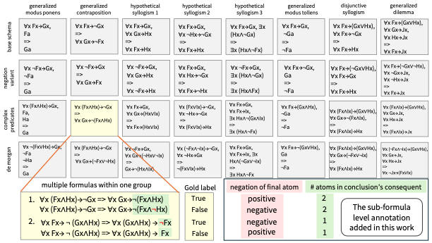

# SFAAC

SFAAC is constructed for analyzing biases in language models induced by sub-formula level structures in the paper "Neuro-Symbolic Reasoning with External Inference Tools Mitigates Bias from Sub-Formula Level Logical Structure", accepted for EMNLP 2026 main.

SFAAC is a dataset created by adding sub-formula level annotations to the test set of AAC (Bets et al., 2021) ([paper](https://aclanthology.org/2021.iwcs-1.7/)) ([github](https://github.com/debatelab/aacorpus)). 

## Details of sub-formula annotation

AAC is a synthetic corpus with templates, and formulas with the same complexity level are classified into the same group. The label is true/false(not true), and each false formula is generated from a true formula by flipping the negation of the final atom. Therefore, the difficulty of the formulas in the same group is largely determined by the sub-formula factors around the final atom, such as the **negation of the final atom**, and **the number of atoms in the conclusion's consequent**. We newly annotate these sub-formula factors for formulas in AAC.

## Format

Each file is JSON Lines, with one Evaluation Pair per line. Newly added keys in SFAAC are following:

- `num_atoms_CC`: the number of atoms in the conclusion's consequent of the text., one of `0`, `1`, or `2`. Main annotation.
- `final_atom_neg`: the negation of the final atom, either `positive` or `negative`. Main annotation.
- `evaluation_text`: Input text for evaluation.
- `gold_label`: gold label of `evaluation_text`, either `true` or `false`.
- `Qwen3`: whether the item is used or not with Qwen3 in our paper.

Other keys are originally generated by AAC.